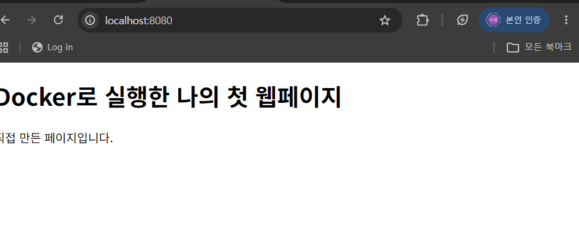
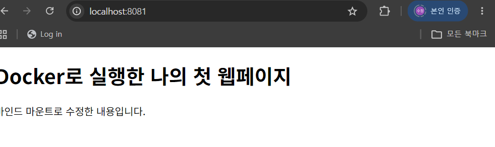
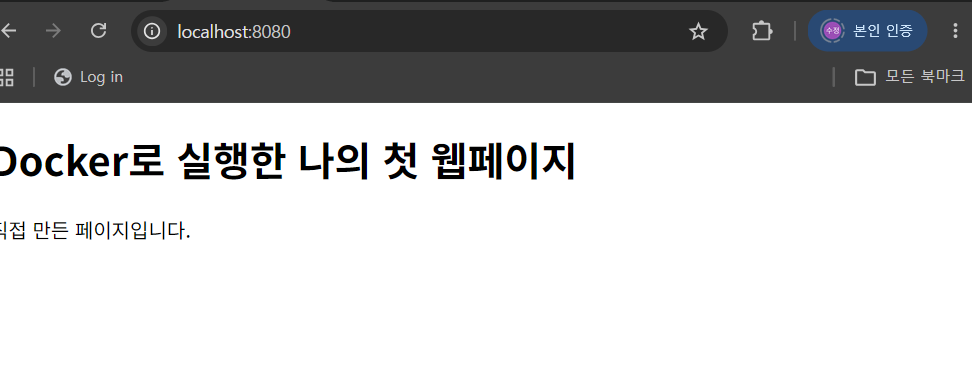

# 나의 첫 개발 환경 만들기

터미널로 파일과 폴더를 다루고, Docker로 Ubuntu와 웹 서버를 실행하며, 포트 연결과 저장 공간의 차이를 확인한 실습 기록입니다. 다른 사람도 명령과 실제 증거를 보고 과정을 이해할 수 있도록 정리했습니다.

최종 정리일: **2026년 11월 2일**

현재까지 터미널 기본 조작, Docker 상태 확인, Ubuntu 운영, Linux 권한 변경, Dockerfile 빌드, 8080·8081 접속, 바인드 마운트 변경 반영을 진행했습니다. GitHub 저장소를 별도 폴더에 clone하고 실습 파일도 복사했습니다. **볼륨의 컨테이너 삭제 후 검증과 Git 설정·최종 업로드는 아직 남아 있습니다.**

## 1 실행 환경

| 항목 | 실제 확인 내용 | 근거 |
| --- | --- | --- |
| 운영체제 | Windows, 빌드 10.0.26200.0 | [터미널 로그](terminal-log.txt) |
| 쉘 | Windows PowerShell 5.1.26100.9711 | [Docker 확인 로그](docker-check-log.txt) |
| 터미널 | VS Code 통합 터미널 | 터미널 로그와 캡처 |
| 컴퓨터 구조 | AMD64 | 기존 hello-world 기록 |
| Docker | 29.9.2, build a82e528 | 기존 버전 기록, 캡처 02·03 |
| Docker 실행 도구 | Docker Desktop, Linux 컨테이너 환경 | Docker 상태·빌드 캡처 |
| Git | 2.55.0.windows.5 | 캡처 37 |
| Ubuntu 이미지 | ubuntu:24.04 | 실행·운영 로그 |
| 웹 서버 베이스 | nginx:alpine | [Dockerfile](Dockerfile) |
| 빌드 당시 웹 서버 | nginx/1.31.8 | 캡처 23의 응답 헤더 |
| 웹 서버 이미지 | my-first-web:1.0 | 빌드·실행 캡처 |

버전은 실습 당시 기록입니다. `nginx:alpine`은 변할 수 있는 태그이므로 나중에 같은 명령을 실행해도 세부 버전까지 동일하다고 보장하지 않습니다.

## 2 수행 체크리스트

- [x] 현재 위치, 숨김 파일을 포함한 목록 확인
- [x] 파일·폴더 생성, 복사, 이동, 이름 변경, 삭제, 내용 읽기
- [x] 빈 파일 생성과 명령·출력 기록
- [x] Docker 설치와 hello-world 성공 기록
- [x] Docker Client·Server 상세 상태 확인
- [x] Ubuntu 컨테이너 실행과 내부 기본 명령
- [x] 새 터미널에서 실행 상태 확인, exec, stop, start
- [x] 이미지 목록, 컨테이너 목록, logs, stats 확인
- [x] 파일과 디렉터리 권한 변경 전후 비교
- [x] Dockerfile 작성, 커스텀 이미지 빌드·실행
- [x] 8080·8081 포트 접속 및 응답 확인
- [x] 바인드 마운트 파일 변경 전후 비교
- [x] Docker 볼륨 생성과 연결, 두 번째 컨테이너에서 데이터 읽기
- [ ] 첫 컨테이너가 실제로 삭제된 것을 확인한 뒤 볼륨 데이터 유지 재검증
- [x] 기존 GitHub 저장소 clone 및 Git 저장소 상태 확인
- [x] 실습 파일 복사와 screenshots 폴더 정리
- [x] 현재 저장소의 Git 작성자 이름 설정 명령 실행
- [ ] Git 작성자 이메일 설정과 최종 결과 확인
- [ ] Git 기본 브랜치 설정과 설정 목록 증거 정리
- [ ] VS Code의 GitHub 로그인·계정 연결 증거
- [ ] 변경 검토, commit, push와 GitHub 최종 반영 확인

`Ctrl+P`, `Ctrl+Q`로 분리하는 실습은 성공하지 않았습니다. 새 터미널을 연 방법을 성공한 detach 실습으로 표시하지 않습니다.

## 3 문서와 증거 파일

현재 저장소의 바깥 폴더가 Git 루트이고, 실습 파일은 그 안의 `my-first-project`에 있습니다.

```text
my-first-project-github/       ← Git 루트 (.git이 있는 위치)
├─ README.md                  ← 안내와 상세 문서 링크
└─ my-first-project/           ← 이 문서와 Dockerfile이 있는 실습 폴더
   ├─ README.md
   ├─ Dockerfile
   ├─ site/index.html
   ├─ screenshots/
   └─ 각 실습의 로그 파일
```

| 기록 | 내용 |
| --- | --- |
| [practice-history.txt](practice-history.txt) | 초기 명령 이력, 출력 전체는 없음 |
| [terminal-log.txt](terminal-log.txt) | 초기 폴더·파일 실습의 실제 출력 |
| [docker-check-log.txt](docker-check-log.txt) | Docker 상세 확인 명령 |
| [ubuntu-practice-log.txt](ubuntu-practice-log.txt) | Ubuntu 대화형 실행 시작 기록 |
| [ubuntu-operations-log.txt](ubuntu-operations-log.txt) | exec, 중지·재시작, 운영·권한 명령 |
| [web-server-log.txt](web-server-log.txt) | HTML·Dockerfile 작성, 웹 서버, 바인드 마운트 |
| [volume-practice-log.txt](volume-practice-log.txt) | 볼륨 생성·연결·데이터 조회 명령 |
| [git-setup-log.txt](git-setup-log.txt) | Git 확인, 저장소 연결 문제와 작성자 설정 |
| [screenshots](screenshots/) | 명령과 출력, 브라우저 접속 증거 |

PowerShell Transcript에는 일부 외부 프로그램의 출력이 빠져 있고, 대화형 Ubuntu 내부의 전체 명령도 남지 않았습니다. 그래서 아래에 실제로 확인한 캡처를 함께 연결했습니다. 로그에 없는 결과를 로그에 있는 것처럼 작성하지 않았습니다. 일부 캡처는 명령의 앞부분이나 웹페이지 왼쪽이 잘려 있으므로 관련 로그·다른 캡처와 함께 확인합니다.

## 4 터미널 기본 실습

다음은 처음 작업 폴더에서 수행한 명령을 정리한 것입니다. 기존 파일이 있는 위치에서 재실행하면 이름 충돌이 날 수 있으며, 삭제 명령은 당시 만든 실습 파일에만 사용했습니다.

```powershell
mkdir my-first-project
cd my-first-project
pwd
dir
dir -Force
"나의 첫 개발 연습입니다" | Out-File memo.txt -Encoding utf8
Get-Content memo.txt
Copy-Item memo.txt memo-copy.txt
Rename-Item memo-copy.txt memo-backup.txt
mkdir practice
Move-Item memo-backup.txt practice
dir practice
Remove-Item practice/memo-backup.txt
dir practice
Remove-Item practice
New-Item empty.txt -ItemType File
cd ..
cd my-first-project
Get-History | Out-File practice-history.txt -Encoding utf8
```

`Get-Content memo.txt`에서 확인한 출력:

```text
나의 첫 개발 연습입니다
```

원본 `memo.txt`는 남겨 두고 복사본과 실습용 빈 폴더만 삭제했습니다. [초기 명령 이력](practice-history.txt), [실제 출력 로그](terminal-log.txt), [메모 파일](memo.txt), [빈 파일](empty.txt)에서 확인할 수 있습니다.

**절대 경로**는 `C:\practice\site`처럼 위치를 처음부터 적은 주소입니다. **상대 경로**는 `site/index.html`처럼 현재 폴더를 기준으로 적은 주소입니다. `..`는 한 단계 위 폴더를 뜻합니다.

명령과 출력을 함께 남길 때는 다음 방식을 사용했습니다. 새 터미널에는 기존 터미널의 기록이 자동으로 이어지지 않아 새 기록을 시작했습니다.

```powershell
Start-Transcript -Path terminal-log.txt -Append
pwd
dir -Force
Get-Content memo.txt
Stop-Transcript
```

## 5 Docker 설치와 상태 확인

기존 설치 과정에서 `docker` 명령을 찾지 못해 설치된 앱을 확인했고, Docker Desktop을 설치했습니다. Virtual Machine Platform 관련 안내가 나와 WSL 설치 안내에 따라 설정과 재시작을 진행했습니다. 당시 WSL 명령의 전체 출력은 보관하지 못했으므로 설치 로그가 완전하다고 주장하지 않습니다.

```powershell
docker --version
docker run hello-world
docker info
```

기존 README에 기록한 실제 출력의 핵심:

```text
Docker version 29.9.2, build a82e528
Hello from Docker!
```

`hello-world`의 첫 `Unable to find image ... locally`는 로컬 이미지가 없어 내려받는다는 안내였고, 이후 정상 메시지가 출력됐습니다. 11월 2일에는 `docker info`의 Client와 Server를 캡처해 Docker 엔진에 연결되는 것을 확인했습니다.

- 캡처 01~04: 기록 시작, Client, Server, 기록 종료
- [Docker 명령 기록](docker-check-log.txt)

## 6 Ubuntu 실행과 컨테이너 운영

```powershell
docker run -it --name ubuntu-practice ubuntu:24.04 bash
```

Ubuntu 내부에서 실행한 명령:

```bash
pwd
ls
echo "Hello from Ubuntu"
```

캡처에서 `/`와 폴더 목록, 출력 문장을 확인했습니다. Bash는 Ubuntu 안에서 명령을 받는 프로그램이며, PowerShell과 구분했습니다.

`Ctrl+P`, `Ctrl+Q`는 현재 터미널에서 동작하지 않아 새 PowerShell을 열었습니다. 이때 기존 Ubuntu는 계속 실행됐고, 새 터미널의 `docker ps`에서 `Up` 상태를 확인했습니다.

새 PowerShell에서 진행한 운영 명령:

```powershell
docker ps
docker exec ubuntu-practice echo "Hello from exec"
docker stop ubuntu-practice
docker ps -a
docker start ubuntu-practice
docker ps
docker images
docker logs ubuntu-practice
docker stats --no-stream ubuntu-practice
```

실제 기록에서 확인한 핵심 결과:

```text
Hello from exec
ubuntu-practice
Exited (137) About a minute ago
ubuntu-practice
Up 52 seconds
```

중지된 상태의 종료 코드는 이 실습에서 **137**이었습니다. 이를 정상 종료 코드 0으로 바꾸어 기록하지 않았습니다. `docker start`로 기존 컨테이너를 다시 켤 수 있음을 확인했습니다.

이미지는 실행 준비물이고 컨테이너는 이미지로 만든 실행 환경입니다. `docker ps`는 실행 중인 컨테이너, `docker ps -a`는 중지된 컨테이너까지 보여줍니다. `docker exec`는 실행 중인 컨테이너에 새 명령을 실행하므로, 원래 프로세스에 연결하는 `attach`와 다릅니다. `attach` 성공 여부는 이번 실습에서 별도로 확인하지 않았습니다.

`docker logs`에는 컨테이너의 주 프로세스 출력이 기록되며 `exec` 출력 전체가 자동으로 포함되는 것은 아닙니다. 실제 logs 출력에는 `root@...:/#`가 남았습니다. `stats --no-stream`은 리소스 사용량을 한 번만 보여줍니다.

- 캡처 05~13: Ubuntu 실행·기본 명령, 실행 상태, exec, 중지·재시작, 이미지·로그·리소스
- [Ubuntu 시작 기록](ubuntu-practice-log.txt), [운영 명령과 실제 출력](ubuntu-operations-log.txt)

## 7 Linux 파일과 폴더 권한

PowerShell에서 Ubuntu 안의 파일과 폴더를 만들고 권한을 비교했습니다.

```powershell
docker exec ubuntu-practice bash -c "mkdir -p /practice && touch /practice/permission.txt && ls -ld /practice /practice/permission.txt"
docker exec ubuntu-practice bash -c "chmod 700 /practice && chmod 600 /practice/permission.txt && ls -ld /practice /practice/permission.txt"
docker exec ubuntu-practice bash -c "chmod 755 /practice && chmod 644 /practice/permission.txt && ls -ld /practice /practice/permission.txt"
```

700·600 변경 후 캡처에서 확인한 권한:

```text
drwx------ ... /practice
-rw------- ... /practice/permission.txt
```

755·644 변경 후 캡처에서 확인한 권한:

```text
drwxr-xr-x ... /practice
-rw-r--r-- ... /practice/permission.txt
```

`r=4`는 읽기, `w=2`는 쓰기, `x=1`은 실행입니다. 세 자리는 소유자·소유 그룹·그 외 사용자 순서입니다. 따라서 7은 4+2+1, 5는 4+1, 6은 4+2입니다. 폴더의 실행 권한은 그 폴더 안으로 들어가는 데 필요합니다. 이번 변경은 컨테이너 내부 실습 파일에만 적용했습니다.

- 캡처 14~16: 변경 전, 700·600, 755·644
- 캡처 17: 운영 기록 종료
- [권한 명령 기록](ubuntu-operations-log.txt)

## 8 Dockerfile로 웹 서버 만들기

실습 폴더에 `site/index.html`을 만들고 첫 문구를 “직접 만든 페이지입니다.”로 저장했습니다. 현재 제출 파일에는 이후 바인드 마운트 실습에서 수정한 문구가 들어 있습니다.

```powershell
New-Item -Name site -ItemType Directory
'<!doctype html><html lang="ko"><head><meta charset="UTF-8"><title>나의 첫 Docker 웹페이지</title></head><body><h1>Docker로 실행한 나의 첫 웹페이지</h1><p>직접 만든 페이지입니다.</p></body></html>' | Set-Content -Path site/index.html -Encoding utf8
Get-Content site/index.html
```

직접 작성한 [Dockerfile](Dockerfile):

```dockerfile
FROM nginx:alpine
LABEL org.opencontainers.image.title="my-first-web"
COPY site/ /usr/share/nginx/html/
EXPOSE 80
```

기존 베이스로 NGINX가 준비된 `nginx:alpine`을 골랐습니다. `LABEL`은 이미지의 목적을 표시하고, `COPY`는 기본 페이지를 제가 만든 정적 콘텐츠로 교체합니다. `EXPOSE 80`은 사용 포트의 설명이며, 이것만으로 내 컴퓨터의 포트에 연결되지는 않습니다.

```powershell
docker build -t my-first-web:1.0 .
docker run -d --name my-first-web -p 8080:80 my-first-web:1.0
curl.exe -i http://localhost:8080
```

빌드 캡처에는 `FINISHED`가 있고, 응답 캡처에는 다음 헤더와 제가 만든 HTML이 있습니다.

```text
HTTP/1.1 200 OK
Server: nginx/1.31.8
Content-Type: text/html
```

`-p 8080:80`은 내 컴퓨터의 8080번을 컨테이너의 80번에 연결합니다. 컨테이너는 별도 네트워크 환경이므로 바깥 브라우저가 접근할 포트 연결이 필요합니다. 브라우저에서 `http://localhost:8080`으로 접속했습니다.



- 캡처 18~23: HTML·Dockerfile 확인, 빌드, 실행, 주소창을 포함한 접속, HTTP 응답
- [웹페이지 소스](site/index.html), [웹 서버 로그](web-server-log.txt)

## 9 바인드 마운트 변경 반영

실습 폴더에서 호스트의 `site`를 컨테이너의 웹 문서 폴더에 연결했습니다.

```powershell
docker run -d --name my-first-web-bind -p 8081:80 --mount "type=bind,source=${PWD}\site,target=/usr/share/nginx/html,readonly" my-first-web:1.0
```

`${PWD}`는 현재 실습 폴더의 절대 경로입니다. `readonly`는 컨테이너에서 연결 폴더에 쓰는 것을 막지만, 호스트에서 파일을 고치는 것은 가능합니다.

먼저 `http://localhost:8081`의 원래 문구를 캡처한 뒤 파일을 수정했습니다.

```powershell
(Get-Content -Path site/index.html -Raw -Encoding utf8).Replace('직접 만든 페이지입니다.', '바인드 마운트로 수정한 내용입니다.') | Set-Content -Path site/index.html -Encoding utf8
curl.exe http://localhost:8080
curl.exe http://localhost:8081
```

브라우저에서는 Ctrl+F5로 새로고침했습니다. 이미지를 다시 빌드하거나 컨테이너를 재시작하지 않았습니다.

| 비교 | 실제 화면에서 확인한 문구 | 이유 |
| --- | --- | --- |
| 8080 | 직접 만든 페이지입니다. | 빌드 당시 이미지에 복사한 파일 사용 |
| 8081 | 바인드 마운트로 수정한 내용입니다. | 호스트의 수정된 파일을 직접 사용 |





- 캡처 24~29: 연결 명령, 변경 전후, 원래 서버 비교, 응답 비교, 기록 종료
- [웹 서버·마운트 로그](web-server-log.txt)

**재현할 때 주의할 점:** 현재 `site/index.html`은 이미 수정된 상태입니다. 변경 전후 비교를 다시 하려면 8절의 원래 HTML을 저장한 상태로 이미지를 먼저 빌드하고, 이후 이 절의 수정 명령을 실행해야 합니다. 수정된 파일로 처음부터 빌드하면 두 서버 모두 수정된 문구를 보여 차이가 나지 않습니다. 컨테이너 이름과 포트를 이미 쓰는 PC에서는 기존 상태를 먼저 확인하고, 별도 실습용 이름·포트를 사용합니다.

## 10 Docker 볼륨 실습과 남은 검증

볼륨을 만들고 첫 컨테이너에 연결했습니다.

```powershell
docker volume create my-first-data
docker run -d --name volume-practice-1 --mount type=volume,source=my-first-data,target=/data ubuntu:24.04 sleep infinity
```

생성 결과:

```text
my-first-data
```

데이터 기록과 첫 컨테이너 삭제는 다음과 같이 **서로 다른 두 명령으로 실행하려고 했습니다.**

```powershell
docker exec volume-practice-1 bash -c "echo 'My volume data survives' > /data/message.txt && cat /data/message.txt"
docker rm -f volume-practice-1
```

그러나 실제 로그와 캡처 33에는 첫 명령 뒤에 `docker rm -f volume-practice-1`이 붙어 있습니다. 별도의 삭제 성공 출력은 없습니다. **따라서 첫 컨테이너가 삭제됐다고 확인할 수 없으며, 이 두 줄은 완료된 실제 출력이 아니라 의도했던 절차입니다.**

이후 두 번째 컨테이너를 만들고 같은 볼륨의 파일을 읽은 것은 캡처 34·35에서 확인했습니다.

```powershell
docker run -d --name volume-practice-2 --mount type=volume,source=my-first-data,target=/data ubuntu:24.04 sleep infinity
docker exec volume-practice-2 cat /data/message.txt
```

캡처 35의 실제 출력:

```text
My volume data survives
```

여기까지는 **두 번째 컨테이너에서도 같은 볼륨의 데이터를 읽었다**는 증거입니다. 과제의 “첫 컨테이너 삭제 전후 데이터 유지” 완료 증거로는 부족합니다. 후속 실습에서 첫 컨테이너 상태를 확인하고, 삭제를 별도 명령으로 수행한 결과와 그 뒤의 데이터 읽기 결과를 새로 남겨야 합니다. 기존 볼륨 데이터는 임의로 지우지 않습니다.

- 캡처 30~36: 볼륨 생성부터 실습 기록 종료까지
- [볼륨 원본 로그](volume-practice-log.txt)

바인드 마운트는 호스트의 특정 폴더를 연결하고, 이름 있는 볼륨은 Docker가 관리하는 저장 공간을 연결한다는 차이를 배웠습니다. 볼륨 삭제와 컨테이너 삭제는 다른 작업입니다.

## 11 Git 저장소 연결과 파일 정리

Git 버전 캡처에서 다음 출력을 확인했습니다.

```powershell
git --version
```

```text
git version 2.55.0.windows.5
```

처음 작업한 폴더에서 `git status`를 실행하니 다음 오류가 나왔습니다.

```text
fatal: not a git repository (or any of the parent directories): .git
```

숨김 파일을 포함해 확인했을 때 `.git`이 없었습니다. 기존 실습 파일을 지우거나 그 폴더에서 새 이력을 만들지 않고, 상위 폴더에 기존 원격 저장소를 별도로 내려받았습니다.

```powershell
cd ..
git clone https://github.com/sunflower129-max/my-first-project.git my-first-project-github
cd my-first-project-github
git status
```

clone 결과의 핵심:

```text
Cloning into 'my-first-project-github'...
Receiving objects: 100% (8/8), done.
```

새 저장소 상태 캡처:

```text
On branch main
Your branch is up to date with 'origin/main'.
nothing to commit, working tree clean
```

기존 실습 결과를 복사하고 PNG를 한 폴더에 정리했습니다. 아래 명령들은 Git 루트인 `my-first-project-github`에서 실행했습니다.

```powershell
Copy-Item -Path '..\my-first-project\*' -Destination '.\my-first-project' -Recurse
git status
Move-Item -Path '.\my-first-project\*.png' -Destination '.\my-first-project\screenshots\'
Get-ChildItem -Path '.\my-first-project\screenshots' -Name
```

파일 복사 뒤의 `Untracked files`는 아직 저장하지 않은 새 파일이라는 뜻입니다. 빨간 파일 이름이나 한글 이름이 `\352...`처럼 표시되는 현상 자체는 파일 손상을 뜻하지 않습니다. 원래 실습 폴더도 보존했습니다.

작성자 이름·이메일을 확인한 뒤, 이름만 현재 저장소에 설정했습니다.

```powershell
git config --get user.name
git config --local user.name "sunflower129-max"
git config --get user.email
```

처음 이름 조회와 이메일 조회는 출력이 없었습니다. 이름 설정 명령은 오류 없이 실행됐지만 최종 조회 캡처는 아직 없습니다. 이메일은 미설정 상태이며 GitHub의 `@users.noreply.github.com` 주소를 확인하는 단계에서 멈췄습니다. 이름 설정만으로 GitHub 로그인이 완료되는 것은 아닙니다.

Git은 내 컴퓨터의 변경 이력을 관리하는 도구이고, GitHub는 원격 저장소를 공유하는 서비스입니다. 공개 저장소의 clone 성공만으로 본인 계정의 push 권한이나 VS Code 로그인까지 확인되는 것은 아닙니다. 기본 브랜치 설정·이메일 설정·VS Code 로그인 증거·최종 commit/push는 이후에 마무리합니다.

- 캡처 37~40: Git 버전, 원래 폴더의 오류, clone, 새 저장소 상태
- [Git 설정 로그](git-setup-log.txt)

## 12 문제 해결 기록

| 문제 | 원인 가설 | 확인한 내용 | 해결 또는 현재 상태 |
| --- | --- | --- | --- |
| docker 명령을 찾지 못함 | 미설치 또는 PATH 문제 | 설치된 앱에서 Docker를 찾지 못함 | Docker Desktop 설치와 재시작 후 버전·hello-world 확인 |
| Virtual Machine Platform 설치 오류 | 필수 Windows 기능 비활성화 | 설치 화면의 기능·관리자 권한 안내 | WSL 설치 안내에 따라 설정 후 재시작, 전체 설치 출력은 미보관 |
| Docker 첫 화면을 닫아 시작되지 않음 | 약관 단계 미완료 | Accept 대신 Close를 선택한 상황 확인 | Docker Desktop을 다시 실행해 약관 단계를 진행 |
| Start-Transcript에서 Appendcd 오류 | 두 명령을 붙여 입력함 | 매개 변수 이름 Appendcd 오류 | Ctrl+C로 취소하고 폴더 이동·기록 명령을 각각 실행 |
| Ubuntu에서 Ctrl+P, Ctrl+Q가 작동하지 않음 | 단축키 전달 문제 가능성 | root 프롬프트가 유지됨 | 새 PowerShell에서 docker ps로 Up 확인, detach 성공으로 기록하지 않음 |
| 로그에 외부 명령 출력이 비어 있음 | Transcript가 모든 화면 출력을 담지 못함 | Docker 명령은 있으나 결과가 빠진 파일 확인 | 캡처를 함께 연결, 없는 출력을 만들어 넣지 않음 |
| 볼륨 삭제 단계의 명령이 붙음 | 줄별 실행이 분리되지 않음 | 로그·캡처에 두 명령이 붙고 삭제 출력이 없음 | 두 번째 컨테이너의 읽기는 확인, 삭제 후 검증은 미완료로 표시 |
| not a git repository | 현재 폴더에 .git이 없음 | 숨김 목록에서 .git 미확인 | 별도 폴더에 clone하고 실습 파일 복사, 새 저장소 status 성공 |
| 한글 파일명이 숫자 코드처럼 보임 | Git의 비ASCII 경로 표시 방식 | status 목록과 실제 파일 이름 비교 | 파일 이름을 바꾸지 않고 실제 경로로 정리 |
| Git 작성자 이름·이메일 조회가 비어 있음 | 사용자 정보 미설정 | 두 조회 명령의 출력 없음 | 이름은 local 설정, 이메일은 아직 미설정 |
| codex 명령을 찾지 못함 | CLI 미설치 또는 PATH 미등록 가능성 | git-setup-log.txt의 CommandNotFoundException | CLI 문제는 해결하지 않음, README 정리와 별개로 남김 |

## 13 캡처 증거 모음

각 링크는 실제 파일 이름을 사용합니다. 캡처 파일 이름만으로 성공을 판정하지 않았으며, 볼륨의 32·33은 위에서 설명한 불완전한 증거입니다.

- [01-docker-기록시](screenshots/01-docker-기록시.png)
- [02-docker-상태확인-Client](screenshots/02-docker-상태확인-Client.png)
- [03-docker-상태확인-server](screenshots/03-docker-상태확인-server.png)
- [04-docker-기록종료](screenshots/04-docker-기록종료.png)
- [05-ubuntu-실행](screenshots/05-ubuntu-실행.png)
- [06-ubuntu-기본명령](screenshots/06-ubuntu-기본명령.png)
- [07-ubuntu-실행상태](screenshots/07-ubuntu-실행상태.png)
- [08-ubuntu-exec](screenshots/08-ubuntu-exec.png)
- [09-ubuntu-중지확인](screenshots/09-ubuntu-중지확인.png)
- [10-ubuntu-재시작확인](screenshots/10-ubuntu-재시작확인.png)
- [11-docker-이미지목록](screenshots/11-docker-이미지목록.png)
- [12-ubuntu-로그확인](screenshots/12-ubuntu-로그확인.png)
- [13-ubuntu-리소스확인](screenshots/13-ubuntu-리소스확인.png)
- [14-권한-변경전](screenshots/14-권한-변경전.png)
- [15-권한-변경후](screenshots/15-권한-변경후.png)
- [16-권한-755-644](screenshots/16-권한-755-644.png)
- [17-ubuntu-운영기록종료](screenshots/17-ubuntu-운영기록종료.png)
- [18-웹페이지-파일확인](screenshots/18-웹페이지-파일확인.png)
- [19-Dockerfile-확인](screenshots/19-Dockerfile-확인.png)
- [20-웹서버-이미지빌드](screenshots/20-웹서버-이미지빌드.png)
- [21-웹서버-컨테이너실행](screenshots/21-웹서버-컨테이너실행.png)
- [22-웹서버-8080접속](screenshots/22-웹서버-8080접속.png)
- [23-웹서버-응답확인](screenshots/23-웹서버-응답확인.png)
- [24-바인드마운트-실행](screenshots/24-바인드마운트-실행.png)
- [25-바인드마운트-변경전](screenshots/25-바인드마운트-변경전.png)
- [26-바인드마운트-변경후](screenshots/26-바인드마운트-변경후.png)
- [27-기존이미지-변경없음](screenshots/27-기존이미지-변경없음.png)
- [28-바인드마운트-응답비교](screenshots/28-바인드마운트-응답비교.png)
- [29-웹서버-기록종료](screenshots/29-웹서버-기록종료.png)
- [30-볼륨-생성](screenshots/30-볼륨-생성.png)
- [31-볼륨-컨테이너연결](screenshots/31-볼륨-컨테이너연결.png)
- [32-볼륨-삭제전-데이터](screenshots/32-볼륨-삭제전-데이터.png)
- [33-볼륨-첫컨테이너삭제](screenshots/33-볼륨-첫컨테이너삭제.png)
- [34-볼륨-새컨테이너연결](screenshots/34-볼륨-새컨테이너연결.png)
- [35-볼륨-삭제후-데이터유지](screenshots/35-볼륨-삭제후-데이터유지.png)
- [36-볼륨-기록종료](screenshots/36-볼륨-기록종료.png)
- [37-git-버전확인](screenshots/37-git-버전확인.png)
- [38-git-저장소연결오류](screenshots/38-git-저장소연결오류.png)
- [39-git-저장소내려받기](screenshots/39-git-저장소내려받기.png)
- [40-git-저장소연결확인](screenshots/40-git-저장소연결확인.png)

## 14 앞으로 마무리할 항목

1. 볼륨 실습에서 첫 컨테이너가 실제로 삭제됐는지 확인하고, 삭제 후에도 같은 데이터가 보이는 결과를 새로 캡처합니다.
2. GitHub에서 제공하는 noreply 이메일을 설정하고 이름·이메일·기본 브랜치 설정 증거를 남깁니다.
3. 설정과 로그를 공개하기 전에 비밀번호·토큰·인증 코드·개인키 등 민감정보를 확인하고 가립니다. 개인 이메일이 들어간 설정 출력도 공개 전에 검토합니다.
4. VS Code GitHub 로그인·원격 연결을 확인합니다. 인증 화면·비밀번호·토큰은 캡처하지 않습니다.
5. 필요한 변경만 검토해 commit하고, push 후 GitHub에서 README·소스·로그·이미지 링크가 열리는지 확인합니다.

이 README 업데이트는 로컬 문서 정리입니다. 이 문서가 GitHub에 올라갔다고 가정하지 않으며, 최종 업로드는 아직 수행하지 않았습니다. 진행 중인 `git-setup-log.txt` 기록도 이후 종료해야 합니다.

## 15 같은 환경에서 따라 하는 방법

GitHub 저장소를 내려받는 위치는 원하는 폴더로 바꿀 수 있습니다.

```powershell
git clone https://github.com/sunflower129-max/my-first-project.git my-first-project-github
cd my-first-project-github
cd my-first-project
```

이 실습 폴더에서 8절의 HTML 작성 → Dockerfile 확인 → 빌드 → 8080 실행 → 9절의 8081 마운트 → 파일 수정 순서로 진행합니다. 6~7절은 Ubuntu와 권한 실습, 10절은 볼륨 실습을 설명합니다. 기록에 나온 컨테이너와 파일이 이미 있는 PC에서는 상태를 확인한 뒤 별도 이름으로 실습하고 기존 데이터를 임의로 삭제하지 않습니다.

Windows PowerShell용 `${PWD}\site` 경로 표기는 다른 OS의 쉘에서 그대로 사용할 수 없습니다. Ubuntu 내부 명령과 Windows PowerShell 명령을 구분해야 합니다. 로그와 캡처는 기존 학습 PC의 결과이며, 모든 PC에서 동일한 컨테이너 ID·시간·버전이 나오지는 않습니다.
